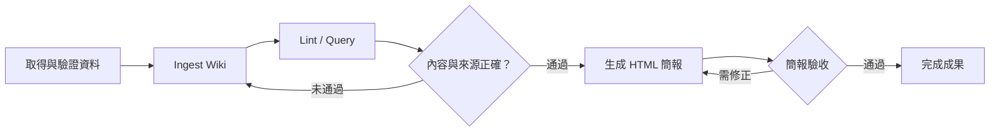

# RAG LLM Wiki｜檢索增強生成入門

本專案是生成式 AI 課程作業。以五篇原始研究建立可追溯的 Markdown 知識庫，並將已查核的內容整理成九頁離線教學簡報。設計參考 Andrej Karpathy 的 LLM Wiki，讓每次入庫的證據能整合進既有概念，供後續查詢與教學使用。[LLM Wiki 設計原文](https://gist.github.com/karpathy/442a6bf555914893e9891c11519de94f)

## 瀏覽成果

- 從 [Wiki 索引](wiki/index.md)依主題閱讀。重要主張附 Wiki 來源頁、原文章節或頁碼，再由來源頁開啟對應版本的 arXiv PDF。
- 下載專案並解壓縮，保留目錄結構，用瀏覽器開啟 [slides/rag-intro.html](slides/rag-intro.html)。簡報內嵌樣式及互動，能離線翻頁、練習和展開來源。前六頁教 RAG 基礎，後三頁用虛構期末專案文件示範與查核。線上 arXiv 全文需要網路。[逐頁來源對應](docs/slide-source-map.md)
- [課程成果摘要](docs/submission.md)提供繳交文件導覽。

| 公開入口 | 網址 |
|---|---|
| GitHub 儲存庫 | 待補 |
| 線上簡報 | 待補 |

## 五篇論文來源

| Wiki | 研究與固定版本 |
|---|---|
| [S01](wiki/sources/S01.md) | Lewis 等人，[Retrieval-Augmented Generation for Knowledge-Intensive NLP Tasks](https://arxiv.org/abs/2005.11401v4) |
| [S02](wiki/sources/S02.md) | Karpukhin 等人，[Dense Passage Retrieval for Open-Domain Question Answering](https://arxiv.org/abs/2004.04906v3) |
| [S03](wiki/sources/S03.md) | Liu 等人，[Lost in the Middle: How Language Models Use Long Contexts](https://arxiv.org/abs/2307.03172v3) |
| [S04](wiki/sources/S04.md) | Es 等人，[Ragas: Automated Evaluation of Retrieval Augmented Generation](https://arxiv.org/abs/2309.15217v2) |
| [S05](wiki/sources/S05.md) | Asai 等人，[Self-RAG: Learning to Retrieve, Generate, and Critique through Self-Reflection](https://arxiv.org/abs/2310.11511v1) |

五篇皆已 Ingest，版本 ID、全文入口與入庫狀態見[公開來源清冊](wiki/source-catalog.md)。`raw/` 是本機原件和工作清冊的存放區，已列入 Git 忽略規則。

## Wiki 架構與操作

| 層級 | 內容 |
|---|---|
| Raw Sources | 本機保存固定版本、唯讀的 PDF。公開版以 arXiv 連結追溯原件。 |
| Wiki | 五個來源頁、五個概念頁、索引、公開清冊與操作日誌。 |
| Schema | [AGENTS.md](AGENTS.md) 定義維護與引用規則，並有[來源頁](docs/templates/source.md)及[概念頁](docs/templates/concept.md)範本。 |

- **Ingest（入庫）**：確認原文與版本，整理來源頁，把證據併入相關概念並更新索引。
- **Query（查詢）**：從 Wiki 尋找證據，作答時附來源、版本和原文位置。缺乏證據的部分會明確標示。
- **Lint（查核）**：檢查連結、錨點、來源代號、索引和孤立頁，再另外比對原文確認主張是否受到支持。

本專案以 LLM Wiki 整合 RAG 研究知識，透過資料取得、Ingest、Query、Lint 與來源驗證，將知識轉換為教學型 HTML 簡報。

### Workflow 總覽

此圖呈現主要的作業流程與回饋循環。完整的檢查節點、資料取得重試及流程改善紀錄請參閱詳細文件。

### 驗證結果

- **Wiki**：五篇指定版本已入庫，10 個知識頁皆有索引及入站連結。整體驗收核對 25 個證據區塊，並完成五題跨來源 Query。不同 Chunking 策略的效果仍待補證。[Wiki 驗收](docs/final-wiki-validation.md)
- **簡報**：最近一次 Edge 離線驗證逐頁測試三種 16:9 桌面及一種手機尺寸，完成導覽、來源開合、示範與練習檢查。[簡報驗證](docs/slide-validation.md)
- **執行紀錄**：入庫、錯誤、修正與複驗皆可回查。[操作日誌](wiki/log.md)

### 詳細流程與反思

- [完整工作流程](docs/workflow.md)：資料取得、入庫、查詢、查核、簡報生成及瀏覽器驗證。
- [流程改善與反思](docs/workflow-reflection.md)：改善前後的 Mermaid Graph、錯誤分析、檢查提前與複驗紀錄。
