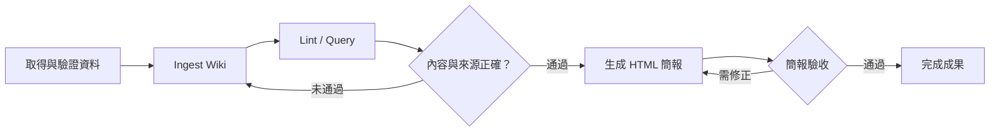

# 生成式 AI 課程作業｜RAG LLM Wiki 成果摘要

成果可從 [Wiki 索引](../wiki/index.md)或[九頁離線簡報](../slides/rag-intro.html)開始閱讀。以下依本次要求整理成六個繳交部分。

## 1．三層 LLM Wiki 與操作規範

`raw/` 保存原始來源與清冊，`wiki/` 保存來源頁、概念頁、索引及操作紀錄，`AGENTS.md` 規範 Ingest、Query、Lint、引用與紀錄方式。現有知識頁共 10 頁，包含五個來源頁與五個概念頁。從概念可沿來源頁的證據錨點回查原文。[Wiki 索引](../wiki/index.md) · [操作規範](../AGENTS.md)

## 2．五篇原始研究 Ingest

| 來源 | arXiv 版本 | 收錄主題 |
|---|---|---|
| [S01](../wiki/sources/S01.md) | 2005.11401v4 | 原始 RAG 的檢索與生成 |
| [S02](../wiki/sources/S02.md) | 2004.04906v3 | DPR 與檢索評估 |
| [S03](../wiki/sources/S03.md) | 2307.03172v3 | 長上下文中的證據位置 |
| [S04](../wiki/sources/S04.md) | 2309.15217v2 | Ragas 的三項評估面向 |
| [S05](../wiki/sources/S05.md) | 2310.11511v1 | Self-RAG 的按需檢索與反思標記 |

五篇均已入庫，原始 PDF 保持唯讀。逐篇將原文證據整合進既有或新建的概念頁，並保留實驗條件。[來源清冊](../wiki/source-catalog.md)

## 3．Query、Lint 與證據驗收

逐篇入庫後均有 Lint 和 Query 紀錄。全庫另完成五題跨來源 Query，涵蓋 DPR 在原始 RAG 中的角色、檢索成功後仍可能答錯、評估指標、Self-RAG 與 Chunking 的證據缺口。本次複驗五份原件、25 個證據區塊及 9 組原文抽查，10 個知識頁均有索引與入站連結。[Wiki 整體驗收](final-wiki-validation.md) · [本次複驗](workflow-reflection.md)

## 4．Workflow 總覽與回饋循環

與 README 的 Workflow 總覽共用同一張圖。

先取得指定版本的資料並核對原文，再 Ingest 至 Wiki。用 Lint 檢查結構，並以 Query 測試證據是否可追溯。內容或來源未通過時回到 Wiki 修正與複驗。查核通過後，依 Wiki 生成 HTML，簡報若需修正則回到 HTML 製作再驗收。[分階段工作流程](workflow.md)

## 5．初學者九頁 HTML 簡報

前六頁先教 RAG 定義、動機、分工、流程、基本檢索與限制，後三頁用虛構期末專案文件示範檢索、操作證據練習及回顧。簡報可離線開啟，附逐頁 Wiki 來源面板、鍵盤導覽及進度。最近一次瀏覽器驗證涵蓋三種 16:9 桌面與一種手機視窗。交付時另靜態複驗 47 條本機連結與其中 24 個證據錨點。[HTML 簡報](../slides/rag-intro.html) · [來源對應表](slide-source-map.md) · [簡報驗證紀錄](slide-validation.md)

## 6．流程改善、實際紀錄與反思

流程改善將 PDF 版本與原文定位提前到 Wiki 寫入前，並在 HTML 排版前核對逐頁來源。完整前後流程、返回路徑與複驗結果見[流程回顧與反思](workflow-reflection.md)。

首次下載失敗與證據引用修正各 5 件。依實際檢查節點歸類，Wiki 證據與語意查核共抓到 7 件。值得優先防止的是主張沿有效連結連到了範圍不符的證據。簡報由文字卡片經京都情境改為文件問答，將進階內容延至初學者掌握核心流程之後。理解順序是設計判斷，現有驗收記錄的是證據可回查與瀏覽器操作結果。[執行日誌](../wiki/log.md) · [錯誤分析與反思](workflow-reflection.md)
