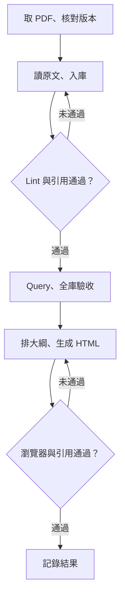
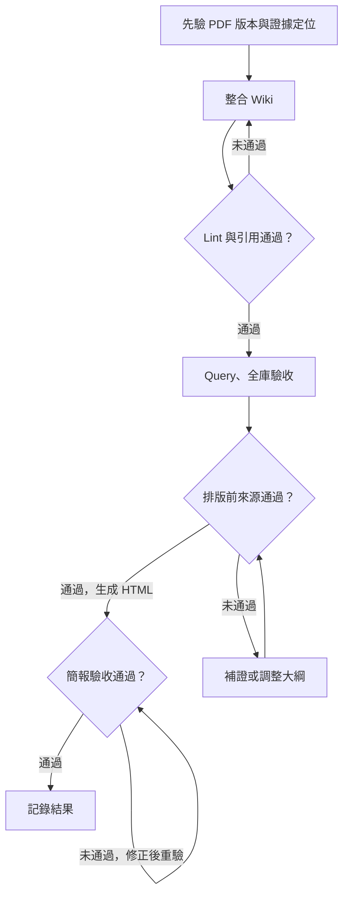

# RAG LLM Wiki 流程回顧與反思

整理與複驗日期：2026-11-23（Asia/Taipei）。

首次下載失敗與引用定位修正各有 5 件。若依工作節點觀察，證據與語意查核還抓到兩項 Wiki 內容表述問題。最值得提前預防的是主張與原文範圍不符，因為這類問題可能沿概念頁、Query 與簡報傳遞，且有效的 Markdown 連結仍可能指向不恰當的證據。[執行日誌](../wiki/log.md) · [Wiki 整體驗收](final-wiki-validation.md) · [簡報驗證](slide-validation.md)

## 最初實際使用的流程

1. **建立規範與清冊**。先按照 Raw Sources、Wiki、Schema 三層建目錄、索引、範本與日誌。將五筆指定版本登為候選。
2. **逐篇取得與整理**。下載指定 arXiv PDF，確認可抽取全文並核對版本，保留原件。閱讀後建立來源頁，再查索引與既有概念，更新相關頁及交叉連結。確認可追溯後才標為已 Ingest。
3. **逐篇驗證並查詢**。檢查索引、來源 ID、內部連結和證據位置，修正後複驗。用 Wiki 作答，沿證據錨點回查原文，保存可重用的知識及操作結果。此序列在 S01～S05 逐篇重複。
4. **全庫驗收與簡報交付**。五篇入庫後，才執行跨來源驗收與五題 Query，並把受支持的內容排成九頁。第一版採虛構作業截止問題，生成單檔 HTML 與來源表，使用 Edge 離線測試後記錄結果。[操作規範](../AGENTS.md) · [初期流程設計](workflow.md) · [Wiki 整體驗收](final-wiki-validation.md)

### 原始流程圖

下圖以實際紀錄重建早期循環，涵蓋第一版 HTML 的完成路徑。無全文可用時的停止分支是當時已有的規則，五次實際下載均在核准重試後成功。



版本與全文確認已在早期流程中執行。可重試時回到下載，無全文時暫停。Lint 發現結構問題便修正 Wiki；原文或引用有問題便回查來源。全庫驗收未通過時依同樣分工修正，再重驗。

## 後續實際調整

- **規則與驗收分層**。整體驗收將機械式連結檢查與語意判讀分開。以 PDF 版本與雜湊確認原件，按原文頁面查圖表及附錄。多欄文字抽取順序和標題空白曾造成誤報，後續改查頁面範圍中的證據標記，並正規化標題格式。
- **教學規劃與 HTML 分開查核**。先由驗收過的 Wiki 排頁，將技術主張、虛構示例與待補證事項分開，再交叉核對 HTML 面板與來源表。改版後用 Edge 逐頁查看桌面及窄視窗，重跑來源開合、按鈕、方向鍵及練習回饋。
- **本次文件化的提前檢查**。在 [工作流程](workflow.md) 補寫兩段檢查順序：先核對 PDF 版本與證據位置，再寫入來源頁；先在教學大綱列出逐頁證據，再進入排版並複驗。前者承接歷次 Ingest 已做的版本確認和後續定位改良，後者承接已有的大綱驗收與來源表比對。本次以現有成品試跑這些檢查，沒有新增來源或回溯宣稱每一版都使用相同時點的檢查。

### 改善後流程圖

此圖將後續實際採用的檢查及本次寫入的提前檢查順序明列。各分支是操作規則，實際發生的問題見下節。



在寫入 Wiki 前分別確認 PDF 版本及主張的原文定位，在生成 HTML 前核對逐頁 Wiki 來源。結構問題回到 Wiki 更新；證據問題回到原文定位。HTML 或來源面板未通過時，修正後重驗。教學順序需要調整時回到大綱。完整返回路徑見[分階段工作流程](workflow.md)。

## 錯誤節點與統計

統計範圍為 S01～S05 入庫、整體 Wiki 驗收及 HTML 各版的既有紀錄。每一獨立修正或首次下載失敗計一件，當次重試、最終複驗與不同文件重述均不再計數。結構類區分交付物缺陷與檢查工具誤報。教學回饋另列為設計決策。

| 類別 | 件數 | 可追溯事件 |
|---|---:|---|
| 資料下載 | 5 | S01～S05 各有一次 HTTPS 連線失敗（curl 7），均以核准的權限重試取得全文。 |
| 證據引用 | 5 | S01 拆分條件生成與機率整合定位；S03 縮窄實驗設計引用；S05 更正附錄 G 為 C.2 表 6；整體驗收再收窄 RAG 基本原理對 S01 的引用，並拆開 S05 摘要的訓練與推論引用。 |
| 內容語意 | 2 | S01 將「摘要式問答」改成「生成式問答」；整體驗收補足 Top-20 命中率以總題數為分母。 |
| 結構與互動 | 1 | 文件問答版補齊練習欄位的 `name`。既有紀錄沒有 S01～S05 的 Wiki 斷鏈或孤立頁缺陷。 |
| 教學呈現及示例一致性 | 1 | 京都草稿的文件未指定第一、第二天，但練習結論指定天序；補齊 D1、D2 後複驗回饋。 |
| **以上合計** | **14** | 五類合計，同件不跨類重複計。 |

另計 **9 件檢查／工具問題**：Wiki 驗收的 S03 圖 7、S04 式 2 抽取順序誤報、S05 標題比對、Windows 萬用字元搜尋各 1 件；HTML 的 Windows 指令過長、靜態漏計封面、缺 Pillow、練習檢查仍用舊頁碼、流程箭頭被量作溢出各 1 件。這些是檢查或建置問題。初期 Git 狀態回報未初始化，與本統計的入庫及驗收範圍無關。[Wiki 問題與修正](final-wiki-validation.md) · [簡報驗證紀錄](slide-validation.md)

歷史教學回饋另外形成四輪調整：增加情境與互動、把主線拉回 RAG 並改善字級、用文件問答取代京都案例並延後進階概念、統一桌面字級與分類標籤。這些回饋沒有用來估算缺陷率。

**最常出錯的節點**：按單一類別，下載與證據引用各 5 件並列。若把語意問題歸入它們實際被發現的 Wiki 內容查核節點，該節點共 7 件，是最密集的交付查核點。**優先預防**：在整合與排版之前查主張、版本、定位和適用條件。下載失敗通常當下可見，證據範圍錯誤則可能隨引用傳到後續產物。

## 本次實際複驗

| 檢查 | 實際測試與結果 |
|---|---|
| 原件與清冊 | 以 pdftotext 重讀五份本機原件。S01～S05 為 19、13、18、8、30 頁。標題、版本、清冊、來源頁 metadata、唯讀狀態及 SHA-256 均通過。 |
| 引用定位與重要主張 | 複驗 25 個證據區塊的頁面定位。另執行 9 組文字抽查，涵蓋 S01 檢索與生成及 ROUGE-L、S02 Top-20 表 2、S03 受控設計與圖 5、S04 WikiEval 一致率、S05 ASQA、門檻及附錄誤判案例。全部通過。 |
| Wiki Lint | 交付文件寫入後重跑，共通過 22 份 Markdown、363 條本機連結及其中 140 條引用錨點。10 個知識頁均有索引與入站連結，五個來源分別有 5、4、3、3、3 個概念頁引用。 |
| HTML 逐頁來源 | 靜態檢查九頁和九筆來源表，47 條本機 HTML 連結中有 24 個證據錨點，皆有效。技術引用和對應表逐頁一致。 |

此輪是既有檔案的靜態與 PDF 複驗。瀏覽器操作結果引用 2026-11-23 的既有測試紀錄。兩張 Mermaid 已寫入本文，並逐項核對節點、分支與返回路徑，未執行渲染測試。這些結果只描述本次資料與檢查條件，無法推得日後的失敗率。[簡報驗證](slide-validation.md)

### 流程圖版面複驗

2026-11-23 在 Edge 無頭瀏覽器使用 Mermaid 10.9.1 實際解析並渲染兩份文件的三張圖，均成功輸出 SVG。先試用分階段子圖，目視發現子圖之間仍有偏長的斜線，且下載回箭頭會影響起點排序，遂改用共用的由上而下布局、就地複驗和具名返回接點。定稿三圖依序渲染出 18／20／28 個節點。此次檢查範圍是本機 Mermaid，GitHub 頁面呈現尚未複驗。

後續將工作流程拆為三階段，將本頁的前後對照各縮為一張短圖，並在繳交摘要沿用 README 總覽。原圖原始碼移至可展開的附錄。使用 Edge 158 與 Mermaid 10.9.1 在 920 px 欄寬實際渲染六張正文圖，全部成功，無水平溢出。橫排對照圖縮放後文字偏小，兩張均改直排後複驗。GitHub 網頁呈現仍待確認。

## 簡報改版歷程與反思

| 版本 | 調整及教學用意 |
|---|---|
| 文字卡片版 | 用「作業何時截止」將九頁串起，加入流程、指標卡與證據練習。資訊可回查，但回饋指出閱讀仍過度依賴文字卡。 |
| 京都情境版 | 以前後一致的虛構文件加入分步流程、模擬排序、K 值、位置與練習。操作更具體，旅遊規則與技術名詞卻同時要求初學者消化。後來先把動機與流程移前並調整字級。 |
| 文件問答版 | 前六頁先教定義、動機、分工、流程、基本檢索與限制。第 7–8 頁才用「期末專案可以兩人一組嗎？」示範檢索與查核，第 9 頁再帶到品質評估與 Self-RAG。單一短文件可讓讀者直接對照「最多兩人」和回答。最後一輪統一字級與分類標籤。 |

先建立 RAG 的心智模型，再練習查證，是這次改版的教學判斷。瀏覽器驗證能確認互動可用與畫面完整，沒有測量學習前後差異，也沒有使用者實驗可證明理解程度提升。[現行 HTML](../slides/rag-intro.html) · [簡報驗證](slide-validation.md)

## 尚未實作的建議

- 若要讓檢查可持續重跑，可將本次暫時命令整理成固定的本機驗收入口，並在每次入庫或改版後保存結果。再加入可渲染 Mermaid 的檢查環境。
- 如課程允許，找沒有 RAG 背景的讀者完成簡短前後測，分開觀察流程理解和證據判斷。
- 若後續需要比較不同 Chunking 或 Embedding 策略，再增補可控比較證據。現有 Wiki 保留該缺口。

## 附錄：完整歷史 Graph 原始碼

以下保留分階段整理前的兩張詳細圖。接點表示回到同代號節點並沿原流程續行。

<details>
<summary>展開早期實際流程</summary>

```text
flowchart TD
    %% 逐篇取得與 Ingest
    A["A · 登記候選與指定版本，取得 PDF"] --> B{"全文可讀且版本吻合？"}
    B -->|下載失敗且可重試| BR(["接點 A：依核准權限重試"])
    B -->|仍無完整可讀原文| BX["暫停 Ingest，保留候選並記錄"]
    B -->|版本不符| BV(["接點 A：重新取得指定版本"])
    B -->|通過| C["讀原文，建立來源頁"]
    C --> D["D · 搜尋並更新概念頁、索引及互連"]
    D --> L{"L · 逐篇結構 Lint 與引用查核通過？"}
    L -->|結構未通過| LS["修正連結、索引或來源 ID"]
    LS --> L
    L -->|原文不支持或定位不精確| LE["回查原文，修正主張或引用"]
    LE --> L
    L -->|通過| Q["標為已 Ingest，執行 Query 並記錄"]
    Q --> W{"五篇均已完成？"}
    W -->|尚有候選| WA(["接點 A：處理下一篇"])
    %% 全庫驗收與第一版簡報
    V{"整體 Wiki 驗收與跨來源 Query 通過？"}
    V -->|結構未通過| VS(["接點 D：修正 Wiki 結構後重驗"])
    V -->|主張或引用未通過| VE(["接點 L：回查原文，修正後重驗"])
    V -->|通過| S["排九頁大綱，生成 HTML 與來源表"]
    S --> T{"Edge 離線與引用檢查通過？"}
    T -->|未通過| TR["修正 HTML 或來源對應"]
    TR --> T
    T -->|通過| Z["記錄第一版驗收"]
    W -->|五篇完成| V
```

</details>

<details>
<summary>展開改善後完整流程</summary>

```text
flowchart TD
    %% 取得原件與提前定位
    A["A · 清冊登記與查重，取得指定 PDF"] --> B{"PDF 全文可讀且首頁版本相符？"}
    B -->|下載失敗且可重試| BR(["接點 A：依可用權限重試"])
    B -->|仍無可讀全文| BX["暫停 Ingest，保留候選並記錄"]
    B -->|版本不符| BV(["接點 A：重新取得指定版本"])
    B -->|通過| C{"C · 寫入前：原文支持主張且位置精確？"}
    C -->|定位不明| CL["複核章節、頁碼或圖表"]
    CL --> C
    C -->|原文不支持| CE["縮小或擱置主張"]
    CE --> C
    %% Wiki Lint 與 Query
    D["D · 更新來源頁、概念頁與索引"] --> L{"Wiki 結構 Lint 與語意查核通過？"}
    L -->|結構未通過| LS["修正斷鏈、索引或 metadata"]
    LS --> L
    L -->|原文不支持或定位不精確| LE(["接點 C：修正主張或引用，重跑 Lint"])
    L -->|通過| Q["標為已 Ingest，執行逐篇 Query 並記錄"]
    Q --> W{"五篇均已完成？"}
    W -->|尚有候選| WA(["接點 A：處理下一篇"])
    W -->|五篇完成| V{"整體 Wiki 驗收與跨來源 Query 通過？"}
    V -->|結構未通過| VS(["接點 D：修正 Wiki 結構後重驗"])
    V -->|主張或引用未通過| VE(["接點 C：回查原文，修正後重驗"])
    %% 逐頁證據與 HTML 驗收
    J["J · 規劃教學順序與逐頁來源"] --> K{"排版前：重要主張都有可用證據？"}
    K -->|未通過| KR["標示缺口或刪減主張"]
    KR --> K
    K -->|通過| M["生成 HTML，更新來源表"]
    M --> N{"來源面板與對應表一致？"}
    N -->|未通過| NR["修正來源連結或對應表"]
    NR --> N
    N -->|通過| T{"Edge 離線與多視窗操作通過？"}
    T -->|版面或互動未通過| TR["修正 HTML 並重測"]
    TR --> T
    T -->|教學回饋需重排| TJ(["接點 J：重排大綱並重跑 HTML 驗收"])
    T -->|通過| Z["記錄結果、修正與複驗"]
    C -->|通過| D
    V -->|通過| J
    classDef check fill:#e7f2ea,stroke:#23715b,stroke-width:2px
    class B,C,L,V,K,N,T check
```

</details>
