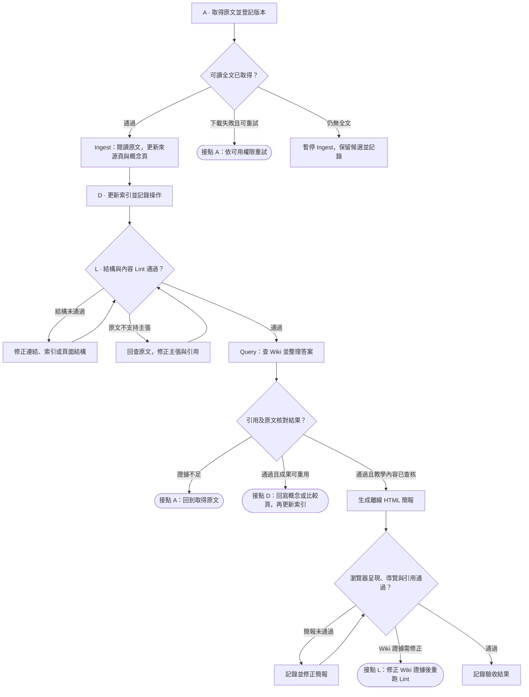

# RAG Wiki 工作流程

下圖保留專案初期的流程設計。實際執行順序、後續增加的檢查與兩張對照圖見[流程回顧與反思](workflow-reflection.md)。

圓角的「接點」表示回到同代號節點並沿原流程續行。短距離的修正與複驗直接畫成回箭頭。

每次 Ingest 都將來源融入既有概念。Query 與簡報先使用 Wiki，再沿引用核對原件。若需要補證，回到資料取得。Lint 發現的問題修正後由原檢查複驗。

| 操作 | 驗收證據 |
|---|---|
| 來源取得與 Ingest | 清冊有版本、日期與原件連結。來源頁和概念頁互連，重要主張可查到原文位置。 |
| Query | 保存問題、答案或成果位置，以及實際核對的引用。 |
| Lint | 保存檢查範圍、結果及各問題的修正與複驗。 |
| 簡報 | 保存 HTML 路徑及實際離線、導覽與引用檢查結果。 |

## 提前檢查

- 寫入來源頁前，比對清冊與 PDF 首頁版本，確認原文可讀。來源頁的每項重要主張先定位到該版本的章節、頁碼或圖表。碰到文字抽取順序或排版差異時，以頁面範圍及原件複核。
- 整理教學大綱時先列出各頁主張與 Wiki 證據。若證據不足，標示缺口或縮小陳述。HTML 排版完成後，再逐頁比對來源表、來源面板及錨點。

操作細節見 [AGENTS.md](../AGENTS.md)，執行結果追加至 [操作日誌](../wiki/log.md)。
