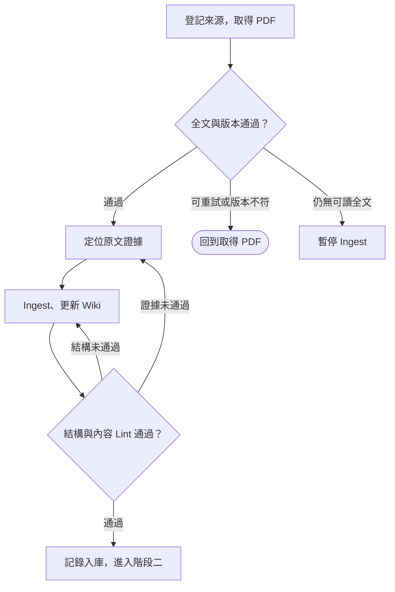
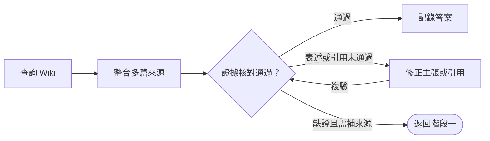
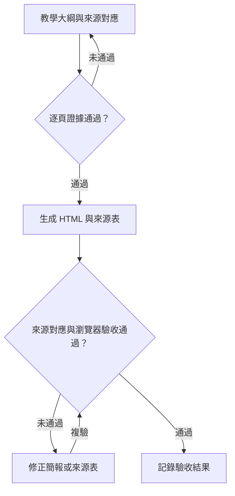

# RAG Wiki 工作流程

每次 Ingest 都將來源融入既有概念。三階段依序銜接，修正後回到相應的查核點。實際執行、早期流程與後續改善見[流程回顧與反思](workflow-reflection.md)。

## 階段一：資料取得與 Wiki 建置



- 以 DOI 或原文網址與版本查重，比對清冊、PDF 首頁版本和全文可讀性。取得失敗但可重試時，依可用權限重試。版本不符時重新取得指定版本。仍無可讀全文時保留候選，記錄原因後暫停。
- 寫入前先定位支持主張的章節、頁碼或圖表，附上研究條件。定位不明時複核原件。原文不支持時縮小陳述或擱置主張。整理後更新來源頁、概念頁、索引與互連。
- 結構 Lint 未通過，修正連結、索引、來源 ID 或頁面結構後重驗。證據未通過，回到原文定位並修正主張或引用，再更新 Wiki 與重跑 Lint。通過且來源可追溯後標為已 Ingest，並記錄操作。

## 階段二：Query 與證據驗證



- 從索引找相關 Wiki 頁面，整合適用的來源，沿引用檢查固定版本與原文。表述或定位不符時修正後再核對。若需要更動 Wiki，回階段一更新並重跑 Lint，再複驗 Query。
- 證據不足時，先標示缺口或縮小回答範圍。確需補充來源時回階段一。經查核且可重用的答案可回寫概念頁或比較頁，並更新索引。
- 逐篇入庫後可執行 Query 並回到階段一處理下一篇。整體 Wiki 驗收與跨來源 Query 通過後，將有證據支持的教學內容交給階段三。

## 階段三：HTML 簡報生成與驗收



- 先安排教學順序與逐頁 Wiki 證據。缺證時標示待補或調整陳述，重新核對再排版。
- 將已查核的大綱生成離線 HTML，核對來源表、頁面來源面板與錨點。用瀏覽器驗證離線載入、版面、導覽與互動，留下修正與複驗結果。
- 版面、互動或來源對應有誤，修正 HTML 或來源表後重驗。若需調整教學順序，回到本階段的大綱。若 Wiki 證據本身有問題，先回階段二回查，必要時回階段一修正 Wiki 並重跑 Lint，再驗收簡報。

| 操作 | 驗收證據 |
|---|---|
| 來源取得與 Ingest | 清冊有版本、日期與原件連結。來源頁和概念頁互連，重要主張可查到原文位置。 |
| Query | 保存問題、答案或成果位置，以及實際核對的引用。 |
| Lint | 保存檢查範圍、結果及各問題的修正與複驗。 |
| 簡報 | 保存 HTML 路徑及實際離線、導覽與引用檢查結果。 |

操作細節見 [AGENTS.md](../AGENTS.md)，執行結果追加至[操作日誌](../wiki/log.md)。

## 附錄：初期完整流程圖原始碼

<details>
<summary>展開分階段整理前的流程</summary>

```text
flowchart TD
    %% 來源取得與知識整理
    A["A · 取得原文並登記版本"] --> B{"可讀全文已取得？"}
    B -->|通過| C["Ingest：閱讀原文，更新來源頁與概念頁"]
    B -->|下載失敗且可重試| BR(["接點 A：依可用權限重試"])
    B -->|仍無全文| BX["暫停 Ingest，保留候選並記錄"]
    C --> D["D · 更新索引並記錄操作"]
    %% Wiki 查核與 Query
    L{"L · 結構與內容 Lint 通過？"}
    L -->|結構未通過| LS["修正連結、索引或頁面結構"]
    LS --> L
    L -->|原文不支持主張| LE["回查原文，修正主張與引用"]
    LE --> L
    L -->|通過| Q["Query：查 Wiki 並整理答案"]
    Q --> V{"引用及原文核對結果？"}
    V -->|證據不足| VA(["接點 A：回到取得原文"])
    V -->|通過且成果可重用| W(["接點 D：回寫概念或比較頁，再更新索引"])
    %% 簡報製作與驗證
    S["生成離線 HTML 簡報"] --> T{"瀏覽器呈現、導覽與引用通過？"}
    T -->|簡報未通過| TR["記錄並修正簡報"]
    TR --> T
    T -->|Wiki 證據需修正| TW(["接點 L：修正 Wiki 證據後重跑 Lint"])
    T -->|通過| Z["記錄驗收結果"]
    D --> L
    V -->|通過且教學內容已查核| S
```

</details>
